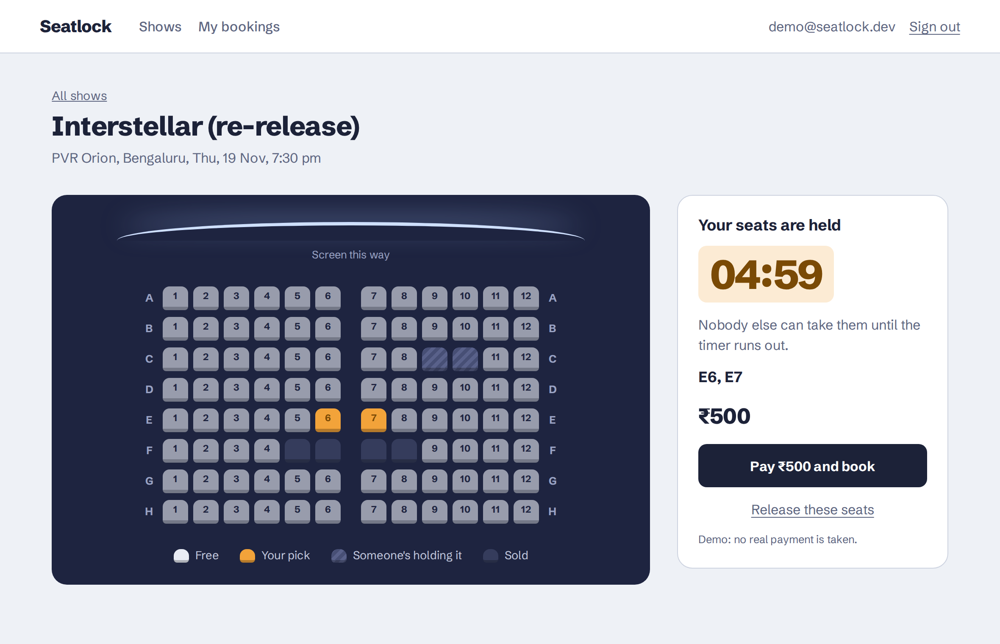

# Seatlock

Pick seats for a show, hold them for five minutes while you pay, and get a ticket. Two people
can click the same seat at the same moment and only one of them gets it.



**Stack:** React + TypeScript (Vite) · Node.js + Express · PostgreSQL · Docker · GitHub Actions

## The problem it solves

A seat booking system has one rule that matters: a seat is never sold twice. The naive version
breaks under load:

```text
user A: SELECT ... seat D6 is free      user B: SELECT ... seat D6 is free
user A: UPDATE seat D6 -> booking A     user B: UPDATE seat D6 -> booking B   (A's seat is gone)
```

Both requests read "free" before either writes, so both succeed. Seatlock prevents this with three
rules, all in [`server/src/bookings.ts`](server/src/bookings.ts):

1. **Lock before you look.** Holding seats starts with `SELECT ... FOR UPDATE` on those seat rows.
   A second request for the same seat waits on the row lock until the first transaction commits.
2. **Check after the lock.** Availability is read in a *new* statement once the locks are held. In
   PostgreSQL's default isolation level each statement sees everything committed before it began,
   so the request that waited now sees the winner's booking and gets a `409`.
3. **Always lock in the same order** (`ORDER BY id`, seats before bookings). A request for seats
   {A, B} and another for {B, A} would otherwise each hold one lock and wait forever for the
   other: a deadlock.

Holds expire without a background job: a seat counts as free when its booking is a `held` booking
whose `expires_at` has passed. Availability is computed, not stored, so a crashed server can never
leave seats stuck.

Confirming is **idempotent**: a double-clicked "Pay" button or a retried request returns the same
booking instead of an error or a second charge.

## Proving it works

`server/test/concurrency.test.ts` fires real parallel HTTP requests at a real PostgreSQL:

| Test | What it checks |
|---|---|
| 50 users click the same seat at once | exactly 1 gets `201`, 49 get `409`, one live booking in the database |
| 40 overlapping multi-seat holds in opposite orders | no deadlocks, no `500`s, no seat owned twice |
| a lapsed hold is confirmed while someone else grabs the seat | never both |
| confirm clicked 5 times at once | one `201`, four `200`, one confirmed booking |

To check the tests actually catch the bugs, each safeguard was removed on purpose and the suite
re-run:

| Removed | Result |
|---|---|
| the `FOR UPDATE` row locks | 50-user test fails: **2 users got the same seat** |
| the `ORDER BY id` lock ordering | overlapping-holds test fails: PostgreSQL reports **deadlocks** |

26 tests in total, including auth (hashed passwords, httpOnly cookies, identical errors for unknown
email and wrong password) and booking rules (expiry, ownership, all-or-nothing holds, 8-seat limit).

## Run it

**With Docker** (one command, nothing else to install):

```bash
docker compose up --build
docker compose exec app node dist/src/seed.js    # adds 3 demo shows
```

Open http://localhost:8080 and sign in as `demo@seatlock.dev` / `seatlock-demo`, or create an
account.

**For development** (Node 22+, and a PostgreSQL on port 55440):

```bash
docker run -d --name seatlock-pg -p 55440:5432 \
  -e POSTGRES_USER=seatlock -e POSTGRES_PASSWORD=seatlock -e POSTGRES_DB=seatlock postgres:16
docker exec seatlock-pg psql -U seatlock -c "CREATE DATABASE seatlock_test"

cd server && npm install && npm run seed && npm run dev    # API on :4000
cd web && npm install && npm run dev                       # app on :5173
cd server && npm test                                      # uses the seatlock_test database
```

## API

| Method | Path | |
|---|---|---|
| `POST` | `/api/auth/signup`, `/api/auth/login`, `/api/auth/logout` | session in an httpOnly cookie |
| `GET` | `/api/shows` | upcoming shows with seats left |
| `GET` | `/api/shows/:id` | seat map; each seat is `available`, `held`, `booked` or `mine` |
| `POST` | `/api/shows/:id/holds` | `{ seatIds }` holds 1 to 8 seats for 5 minutes, all or nothing |
| `POST` | `/api/bookings/:id/confirm` | turns a hold into a booking (idempotent) |
| `DELETE` | `/api/bookings/:id` | releases a hold early |
| `GET` | `/api/bookings` | your bookings |

Errors are JSON: `{ "error": "seats_unavailable", "details": { "seatIds": [42] } }`.

## Layout

```text
server/   Express API, SQL schema, Vitest + Supertest tests
web/      React app: shows list, seat map with live updates, bookings
Dockerfile, docker-compose.yml, .github/workflows/ci.yml
```

## Not done yet

- Payment is simulated; the confirm step is where a Stripe charge would go.
- The seat map refreshes every 3 seconds by polling. Server-sent events would push changes instead.
- One venue layout (8 rows of 12); a real system would store layouts per hall.
